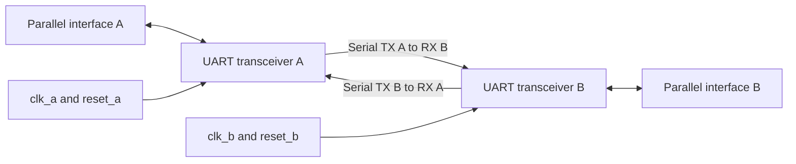
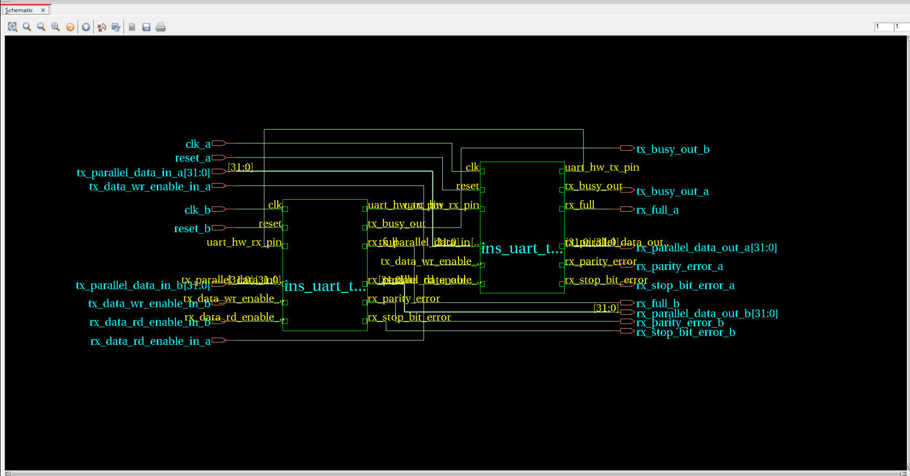
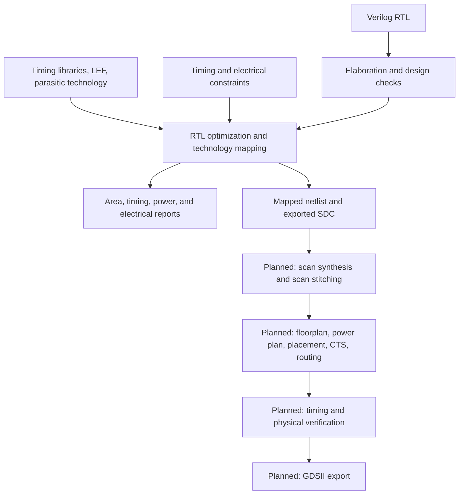

# Digital ASIC Design Flow

**A documented UART ASIC implementation study: RTL synthesis, timing constraints, design for test, and physical implementation.**

This repository records my work on a dual UART transceiver using Cadence tools and educational 45 nm libraries. The completed stage covers RTL elaboration, technology mapping, constraint debugging, area and timing analysis, and experiments with word length, clock waveforms, and output loading. Scan insertion and physical implementation have dedicated folders for the next stages.

**Author:** Ranaweera R.P.D.D.H. · **Index:** 220511N · University of Moratuwa

## Current progress

| Stage | Tool | Status | Evidence |
| --- | --- | --- | --- |
| [RTL synthesis](labs/lab01-rtl-synthesis/README.md) | Cadence Genus 18.10-p003_1 | Completed experiments and report | RTL, console transcripts, reports, screenshots, analysis |
| [DFT and scan insertion](labs/lab02-dft-insertion/README.md) | Cadence Genus | Planned; no results yet | Workflow and evidence checklist |
| [Physical implementation](labs/lab03-physical-design/README.md) | Cadence Innovus | Planned; no results yet | Workflow and evidence checklist |

The repository currently demonstrates **synthesis and analysis**, with electrical violations and functional limitations documented. It does not yet contain a verified scan implementation, routed layout, or GDSII result.

## What I did

- Studied the hierarchy of two cross-connected UART transceivers and traced their transmit, receive, buffering, and sampling logic.
- Loaded timing, physical, and parasitic technology inputs into Genus and investigated library warnings.
- Read and elaborated Verilog RTL, checked the design, uniquified instances, applied constraints, and synthesized a mapped netlist.
- Corrected the B-side output collection: `rx_full_a` was mistakenly selected where `rx_full_b` was required.
- Analyzed two system clocks, synchronous active-high resets, clock uncertainty, external I/O delays, output loads, and timing exceptions.
- Compared an 8-bit baseline with a 32-bit parameter experiment at 100 MHz.
- Changed the constraints to 50 MHz, 40% duty cycle, a 180° phase offset for clock B, and an additional 5 pF output load.
- Reconstructed the worst-path timing calculations and distinguished positive setup slack from maximum-transition violations.
- Identified a fixed three-bit FSM counter that prevents the parameter-only experiment from establishing correct 32-bit UART operation.
- Prepared a 13-page report with screenshots, numerical comparisons, and explanations.

## Design overview

`uart_top` instantiates two copies of `uart_transceiver`. A's serial transmit signal feeds B's receive input, and B's transmit signal feeds A's receive input. Each transceiver has its own clock, reset, parallel transmit interface, and parallel receive interface.



Each transceiver contains an RX wrapper and a TX wrapper, with a buffer, FSM, and sampling-tick generator in each direction. The sampling ticks are **clock enables**, not additional clock signals: the sequential logic runs on the system clock's rising edge.



## ASIC flow and scope



The first stage studies how RTL structure and constraints influence the mapped implementation. Later stages will add testability and physical interconnect, then reassess timing using the implemented design.

## Completed synthesis experiments

All three cases retain one word per buffer and `CLOCK_IN_MHZ = 100` in the RTL. In the final case only the timing/load constraints change relative to the 32-bit design.

| Measurement | 8-bit baseline | 32-bit width experiment | 32-bit clock/load experiment |
| --- | ---: | ---: | ---: |
| TX / RX word length | 8 / 8 | 32 / 32 | 32 / 32 |
| System clock frequency | 100 MHz | 100 MHz | 50 MHz |
| Clock period | 10 ns | 10 ns | 20 ns |
| Duty cycle A / B | 50% / 50% | 50% / 50% | 40% / 40% |
| B rising-edge offset | 0 ns | 0 ns | 10 ns |
| External output load | 0.2 pF | 0.2 pF | 5.2 pF |
| Cell count | 772 | 1130 | 1128 |
| Cell area (µm²) | 2220.948 | 4010.292 | 3807.144 |
| Estimated net area (µm²) | 946.493 | 1403.470 | 1401.987 |
| Reported total area (µm²) | 3167.441 | 5413.762 | 5209.131 |
| Worst slack in supplied 10-path report | +2.539 ns | +2.031 ns | +8.864 ns |
| Registers reported per clock | 83 | 153 | 153 |
| Maximum-transition violation cost | 439 | 1318 | 489032 |

Area is a synthesis estimate from physical libraries, **not die area or a post-route measurement**. The transition violation cost is a tool-reported aggregate, **not the number of failing pins**. Raw evidence and its provenance are indexed in the [Lab 1 README](labs/lab01-rtl-synthesis/README.md) and [manifest](labs/lab01-rtl-synthesis/evidence/manifest.json).

### Main observations

**Word length affects the implementation substantially.** Moving from 8 to 32 bits increased cell count by 46.37%, cell area by 80.57%, and reported total area by 70.92%. The worst supplied setup slack fell by 0.508 ns. Buffer storage and control structure explain much of the area increase; area does not simply scale fourfold.

**A relaxed clock can coexist with severe electrical violations.** At 50 MHz, the worst supplied late-path slack is +8.864 ns. However, the increased output load produces about 7.077 ns transition time on the listed `rx_full` drivers against a 0.280 ns limit. Positive setup slack therefore does not mean every implementation requirement passes.

**Constraints must be interpreted with the RTL.** Keeping `CLOCK_IN_MHZ = 100` while supplying a physical 50 MHz clock slows the sampling/baud timing by approximately a factor of two. The lab's constraint-only experiment demonstrates synthesis behavior, not preservation of the original baud rate.

**Synthesis is not functional verification.** The TX and RX FSMs use `reg [2:0] data_bit_counter`. Those counters represent 0–7, while a 32-bit word requires reaching bit 31. The parameter experiment must not be presented as a functionally verified 32-bit UART. See [limitations](docs/limitations.md).

## Constraint changes

The corrected B output collection is:

```tcl
set design_outputs_b [get_ports {
    tx_busy_out_b
    rx_full_b
    rx_parallel_data_out_b
    rx_parity_error_b
    rx_stop_bit_error_b
}]
```

For the final experiment, the key clock and load settings are:

```tcl
create_clock -name clk_a -period 20 [get_ports clk_a] -waveform {0 8}
create_clock -name clk_b -period 20 [get_ports clk_b] -waveform {10 18}
set_load 5.2 $design_outputs
```

The high time is 8 ns out of 20 ns, giving 40% duty cycle. Clock B starts 10 ns later, which is half the period and therefore 180°. Adding 5 pF to the original 0.2 pF gives **5.2 pF**. These values assume the observed setup's ns/pF units; the reports display ps/fF.

The [constraint templates](labs/lab01-rtl-synthesis/constraints/README.md) are reconstructed from captured commands and results. The supplied `constraints.txt` is a lint report, not the original Tcl source. Newly prepared automation is labeled separately from captured experiment evidence.

## Timing interpretation

For the baseline input-to-register path, the required time is `10 − 0.500 − 0.168 = 9.332 ns`. Arrival is `6.000 + 0.793 = 6.793 ns`, giving `9.332 − 6.793 = +2.539 ns` slack.

For the final B register-to-output path, the launch edge is 10 ns and the capture edge is 30 ns. Required time is `30 − 6 − 0.5 = 23.5 ns`; arrival is `10 + 4.636 = 14.636 ns`. Slack is `23.5 − 14.636 = +8.864 ns`.

Reciprocal A↔B false paths exclude cross-clock timing checks. They do not prove safe clock-domain crossing or validate the serial protocol. The supplied reports cover the ten worst late paths, not a complete multi-corner setup/hold signoff.

## Repository layout

```text
digital-asic-design-flow/
├── README.md
├── PUBLISH.md                     # Connect this prepared repository to GitHub
├── NOTICE.md                      # Source attribution and library boundary
├── .gitignore
├── docs/
│   ├── asic-flow-notes.md          # Concepts and worked calculations
│   ├── limitations.md              # What the current evidence establishes
│   └── workflow.md                 # How to add later results and commits
└── labs/
    ├── lab01-rtl-synthesis/
    │   ├── README.md
    │   ├── rtl/                   # Nine modules extracted from supplied RTL
    │   ├── constraints/           # Corrected, reconstructed Tcl templates
    │   ├── scripts/               # Prepare a fresh Genus experiment workspace
    │   ├── results/               # CSV/JSON summaries with source references
    │   ├── evidence/              # Captured text, screenshots, console logs
    │   ├── netlists/              # Earlier captured 8-bit mapped export
    │   └── report/                # Final PDF and editable Word report
    ├── lab02-dft-insertion/        # Planned scan insertion stage
    └── lab03-physical-design/      # Planned place-and-route stage
```

## Run the prepared synthesis workflow

Cadence Genus and authorized access to the educational technology libraries are required for synthesis. No proprietary libraries, tool binaries, remote-access credentials, lecture slides, or previous-year student reports are bundled.

The new preparation script uses Python 3's standard library. It copies the captured RTL into a fresh run directory, changes only the top-level word-length defaults for the requested experiment, and writes a Genus flow file. **The preparation step has been checked locally; the generated flow has not been rerun in Genus.** The archived numerical results came from the original university-machine runs.

```sh
# Run from the repository root on the Cadence machine.
python3 labs/lab01-rtl-synthesis/scripts/prepare_run.py \
  --experiment baseline8 \
  --library-root /path/to/gsclib045 \
  --run-root work/baseline8

cd work/baseline8/work
genus
# At the Genus prompt:
source ../flow.tcl
```

Use `--experiment width32` or `--experiment clock50_load52` with a different `--run-root` for the other cases. Detailed prerequisites, output files, and rerun rules are in the [Lab 1 guide](labs/lab01-rtl-synthesis/README.md).

## Reports and evidence

- [Final Lab 1 report — PDF](labs/lab01-rtl-synthesis/report/220511N_Lab1_RTL_Synthesis_Report.pdf)
- [Editable report — Word](labs/lab01-rtl-synthesis/report/220511N_Lab1_RTL_Synthesis_Report.docx)
- [Experiment summary — CSV](labs/lab01-rtl-synthesis/results/experiment-summary.csv)
- [Detailed concepts and calculations](docs/asic-flow-notes.md)
- [Evidence manifest](labs/lab01-rtl-synthesis/evidence/manifest.json)

Only the earlier 8-bit mapped netlist was supplied as text. Export screenshots show that netlist/SDC writing was performed, but the later 32-bit and final mapped netlists and their SDC files are not included as captured outputs.

## Next stages

1. **DFT:** compare the functional design, scan-synthesized design, and scan-stitched design; document area, ports, scan-chain structure, and DFT rules. The exercise also investigates additional chains and reducing dedicated scan I/O. ATPG input export is planned; ATPG execution and achieved fault coverage are not claimed.
2. **Physical design:** import the scan netlist, SDC, scanDEF, libraries, and analysis views into Innovus; document floorplanning, power planning, placement, CTS, scan reordering, routing, timing analysis, verification, and GDSII export.

Keep each stage's scripts, reports, screenshots, and findings in its own folder. See the [ongoing workflow](docs/workflow.md) for naming and commit suggestions.

## Attribution

The UART RTL and activity instructions were supplied through the University of Moratuwa Digital IC Design coursework. My contribution here is the execution, constraint correction, experiments, analysis, report, and repository documentation. The captured logs identify the educational 45 nm setup. This repository does not apply a blanket open-source license to externally supplied RTL or technology assets; see [NOTICE.md](NOTICE.md).
